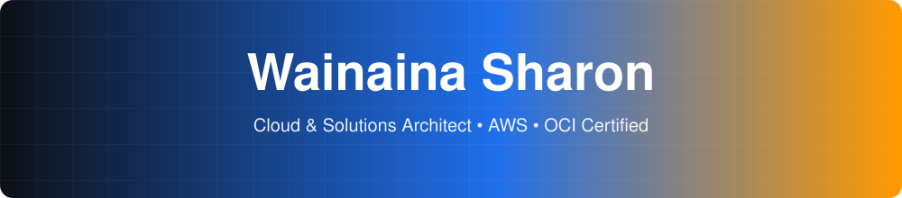

<div align="center">



<a href="https://github.com/nvimah">
  
</a>

<br><br>


</div>

<br>

## 👋 Hey, I'm Sharon

I design cloud systems that are **secure, scalable and a little bit lazy**, because the best infrastructure runs itself.

☁️ **Solutions / Cloud Architect**, AWS first, **OCI certified**, with Azure fundamentals in the toolkit
🔌 **Right now:** building **AWS ⇄ ServiceNow integrations** that connect cloud events to real service workflows
🧠 **Mindset:** design it well, lock it down, monitor it, automate it, then document it
💬 **Ask me about:** AWS architecture, IAM, Lambda, ServiceNow, CMDB, Terraform, n8n workflows

> *"The cloud is just someone else's computer, but with better IAM policies."*

<br>

## 🎛️ Currently

| 🔭 Working on | 🌱 Sharpening | 🎯 Open to |
|:--|:--|:--|
| AWS ⇄ ServiceNow integrations | Kubernetes, Terraform patterns | Cloud architecture projects and collaborations |

<br>

## 🌐 Let's connect

<a href="https://YOUR-PORTFOLIO-URL"></a>
<a href="https://www.linkedin.com/in/YOUR-LINKEDIN-HANDLE"></a>
<a href="mailto:YOUR-EMAIL@example.com"></a>

<br>

## 🧰 My toolbox

<table>
  <tr>
    <th align="left">☁️ Cloud & DevOps</th>
    <th align="left">🛡️ Systems</th>
    <th align="left">⚙️ Automation & Code</th>
    <th align="left">🧩 IT Service Platforms</th>
  </tr>
  <tr>
    <td valign="top">
      <br>
      <br>
      <br>
      <br>
      <br>
      <br>
      
    </td>
    <td valign="top">
      <br>
      <br>
      <br>
      
    </td>
    <td valign="top">
      <br>
      <br>
      <br>
      
    </td>
    <td valign="top">
      <br>
      <br>
      <br>
      
    </td>
  </tr>
</table>

<br>

## 🏗️ How I think about architecture

```text
 design  ──▶  secure  ──▶  automate  ──▶  observe  ──▶  improve
   │            │             │              │             │
 AWS / OCI    IAM +       Terraform,      CloudWatch     repeat
 patterns     Secrets     Lambda, n8n     + alerts       forever
              Manager
```

<br>

## 📊 Stats, but make it dashboard

<table>
  <tr>
    <td align="center">
      
    </td>
    <td align="center">
      
    </td>
  </tr>
  <tr>
    <td colspan="2" align="center">
      
    </td>
  </tr>
</table>

<br>

## 🏆 Trophy cabinet

<div align="center">

<a href="https://github.com/ryo-ma/github-profile-trophy"></a>

</div>

<br>

## 🐍 Snake eating my commits

<div align="center">


</div>

<br>

## ✍️ Fresh off the keyboard

<!-- BLOG-POST-LIST:START -->
<!-- BLOG-POST-LIST:END -->

<br>

<div align="center">

*Built on AWS, powered by coffee, secured by least privilege.* ☕🔐

</div>
